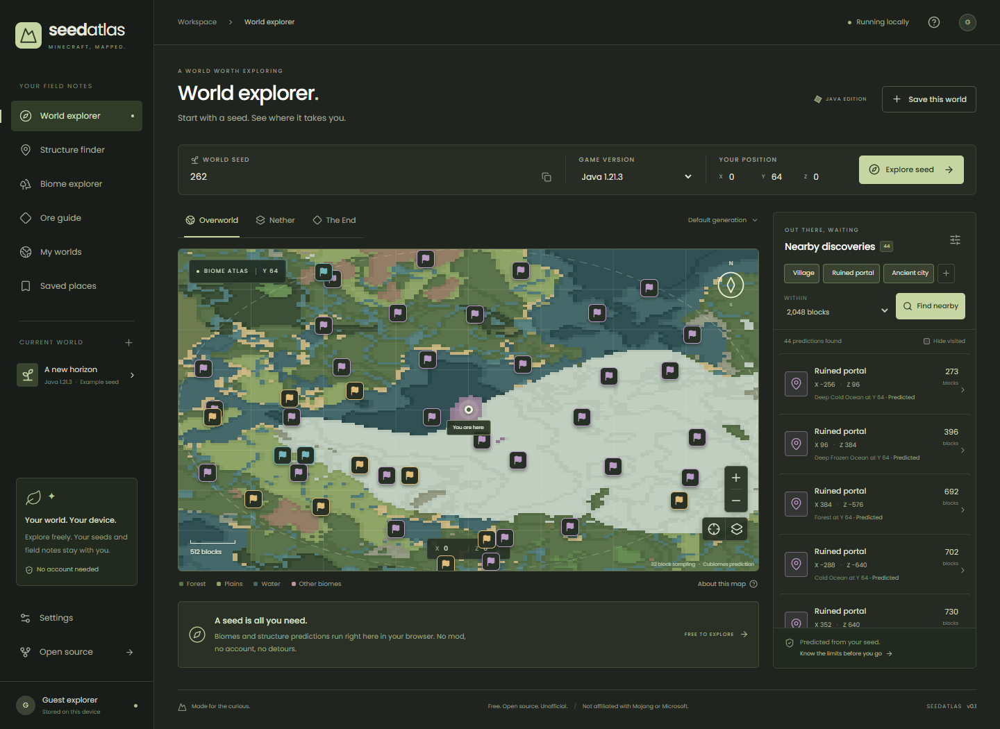

# SeedAtlas

A free, private Minecraft Java atlas. Real biome sampling and structure predictions run in your browser through Cubiomes WebAssembly. No Fabric mod, game installation, account, API key, or backend is required for ordinary exploration.

The interface uses locally bundled Poppins, an ink and moss palette, and original atlas styling. No ads, gradients, subscriptions, trackers, or proprietary Minecraft assets.



## Run locally

Requires Node.js 24 LTS and npm. On Windows use `npm.cmd` if PowerShell blocks the npm script wrapper.

```sh
npm ci
npm run dev
```

Open the Local URL printed by Vite. For a production build:

```sh
npm run build
npm run preview --workspace @seedatlas/web
```

Serve `apps/web/dist` on any static HTTPS host, or on localhost. Root-path hosting is supported. The production build includes an offline service worker and all fonts and engine files. Allow the first online load to finish before going offline. The development server intentionally does not install a service worker.

## What works

- Guest exploration with exact signed 64-bit seed parsing and Java text hashing.
- Browser biome sampling and bounded, biome-checked structure predictions for explicitly listed Java 1.18.2, 1.20.6, and 1.21.3 adapters.
- Overworld, Nether, and End; height-aware biome queries; coordinate validation.
- Interactive map, coordinate grid, search-radius overlay, pan, zoom, and keyboard navigation.
- Structure filters, nearest sampled biome, incremental results and cancellation.
- Independent local world UUIDs, IndexedDB persistence, waypoints and visited status, JSON export.
- Dark/light appearance and educational ore notes with clear limitations.
- Optional Rust/Axum health service and PostgreSQL schema foundation.

The starting seed `262` is an editable example. Every discovery shown is calculated by the shipped engine. Nothing is fabricated.

## Accuracy and current limits

**Enabled generation is predicted, not independently validated against vanilla reference worlds.** Cubiomes cannot confirm every terrain-dependent structure, its full layout, or its Y coordinate. Biomes are sampled at the chosen height and spacing; a missing sample is not proof a biome does not exist nearby. A map is a biome plane, not a terrain-height map. Distances are straight-line horizontal distances.

**Java 26.1, 26.2, 26.3 and 26.4 Snapshot 5 are registered but unsupported.** They never fall back to an older generator. Upstream Cubiomes does not implement these versions. Adding independently validated, properly licensed browser adapters is the next engine milestone. No mod installation is used as a workaround.

Exact ore coordinates, save-file inspection, accounts, synchronization, the Fabric companion, precision runner, custom data packs, and non-default presets are not implemented. The ore guide is historical distribution guidance, not a 26.x ore chart. No fake account or mod-connection controls are provided.

Browser data stays on this device. Clearing browser data removes local progress. Export a backup when needed; backup import and conflict reconciliation are future work. Guest IndexedDB is not a secure multi-user server database. The API exposes no private resources yet.

## Verify

```sh
npm run typecheck
npm test
npm run lint
npm run format:check
npm run build
npm run test:e2e
npm run test:offline
cargo test --workspace --locked
cargo fmt --all -- --check
cargo clippy --workspace --all-targets --locked -- -D warnings
```

Browser tests use installed Google Chrome by default. If Chrome is unavailable, install Playwright Chromium and adjust the `channel` in `playwright.config.ts`. The test server runs on port 5174. Tests include full-width desktop and mobile layouts, worker execution, unsupported versions, persistence, and dimension isolation. A separate production test verifies offline reloads.

The upstream seed 262 mushroom-fields example is a WASM binding regression fixture. It does not establish full vanilla accuracy. See [research](docs/research.md), [architecture](docs/architecture.md), [checklist](docs/checklist.md), and [testing notes](docs/testing.md).

## Rebuild the browser engine

The generated engine is committed so normal frontend development needs no C compiler. To rebuild, install Emscripten 4.0.15, put `emcc` on PATH or set `EMCC`, then:

```sh
npm run build:wasm
```

The build also recognizes a local SDK in `.tools/emsdk`. Upstream source is pinned and vendored under `native/cubiomes`; see [provenance](native/UPSTREAM.md). No unverified 26.x patches are included.

## Optional API and database

Rust stable is required for the service. Browser exploration never calls it.

```sh
cargo run -p seedatlas-api
```

The service listens on `127.0.0.1:3001`, configurable with `SEEDATLAS_BIND`. Routes: `/api/v1/health` and `/api/v1/capabilities`. OIDC and private endpoints are deliberately not exposed before authorization is implemented and tested.

With Docker Compose installed, set `POSTGRES_PASSWORD` in your shell or ignored `.env`, then run `docker compose up -d db`. The initial schema is applied to a new volume. For an existing database, apply versioned migrations explicitly with psql. Do not treat initialization scripts as a production migration manager. See [deployment](docs/deployment.md).

## Open source

MIT application code, MIT Cubiomes, ISC Lucide icons, and SIL OFL Poppins. Attribution and licenses are in [THIRD_PARTY_NOTICES.md](THIRD_PARTY_NOTICES.md) and the distributed `licenses` directory. No Minecraft binaries or game assets are distributed.

An unofficial project. Not approved by or affiliated with Mojang Studios or Microsoft.
